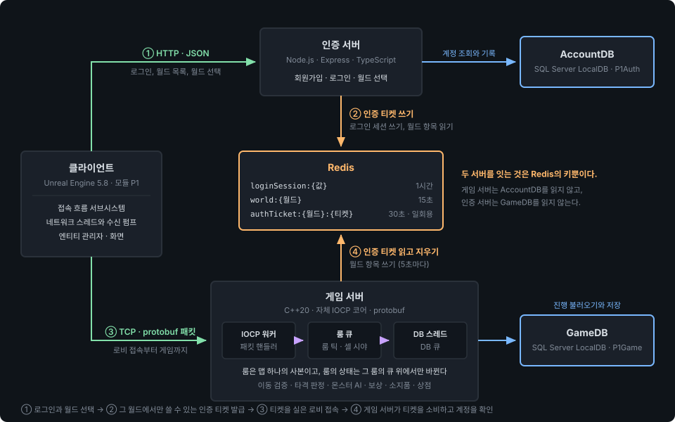

# Project_MMORPG

언리얼 엔진 5 클라이언트, 자체 IOCP C++ 게임 서버, Node.js 인증 서버를 함께 띄우는 3티어 MMORPG다.
클라이언트는 입력과 표현을 맡고, 접속과 이동과 전투와 소지품의 결과는 서버가 정한다.

코드는 2026년 11월 2일의 커밋 `6186a77f`에서 동결했다. 그 뒤의 커밋은 문서만 바꾼다.

## Stack

| 영역 | 사용 기술 |
|---|---|
| 클라이언트 | Unreal Engine 5.8(런처 설치본), C++ 게임 모듈 `P1`, 에디터 모듈 `P1Editor` |
| 게임 서버 | C++20, 자체 IOCP 코어 `ServerCore`, Protocol Buffers, ODBC, Detour(recastnavigation 1.6.0) |
| 인증 서버 | Node.js 24, TypeScript, Express 5, bcrypt |
| 저장소 | SQL Server LocalDB(`AccountDB`, `GameDB`), Redis |
| 생성 도구 | 패킷 핸들러 생성기, 기획 데이터 빌더 DataBuilder(Python), navmesh 빌더 NavBuilder(Recast) |
| 테스트 | GoogleTest, Vitest와 supertest, UE Automation, Python unittest |

## Architecture



- 인증 서버와 게임 서버를 잇는 것은 Redis의 키뿐이다. 게임 서버는 `AccountDB`를 읽지 않고, 인증 서버는 `GameDB`를 읽지 않는다.
- 로그인한 계정이 월드(게임 서버 하나가 맡는 서버군)를 고르면, 인증 서버가 그 월드에서만 쓸 수 있는 일회용 인증 티켓을 Redis에 넣는다. 게임 서버는 티켓의 키를 읽고 지우며, 키를 실제로 지운 연결만 통과시킨다.
- 클라이언트와 게임 서버를 잇는 것은 `.proto`에서 생성한 패킷이다. 클라이언트가 보내는 패킷이 20개, 서버가 보내는 패킷이 29개다.
- 게임 서버의 동시성 단위는 룸이다. 룸은 맵 하나 전체를 시뮬레이션하는 사본이고, 같은 맵의 룸 여럿이 플레이어에게는 채널로 보인다. 패킷 핸들러는 룸의 상태를 직접 바꾸지 않고 그 룸의 잡 큐에 일을 넣는다. 그래서 룸의 상태에는 락이 없다.
- DB 작업은 전용 DB 스레드가 맡는다. DB 스레드는 살아 있는 플레이어를 읽지 않고, 룸의 큐에서 뜬 사본만 저장한다.

깨면 안 되는 규칙과 그 이유는 [docs/ARCHITECTURE.md](docs/ARCHITECTURE.md)에 있다.

## 구현 범위

| 영역 | 구현한 것 |
|---|---|
| 접속 | 회원가입, 로그인, 월드 목록과 월드 선택, 인증 티켓으로 하는 로비 접속. 한 계정의 연결은 하나이고, 나중에 온 접속이 앞의 연결을 끊는다 |
| 로비 | 캐릭터 목록, 생성, 삭제. 직업은 전사 하나다 |
| 입장과 저장 | 게임 입장, 맵 로드 뒤의 룸 입장, 접속 종료와 로비 복귀와 서버 종료에서의 진행 저장. 저장이 끝난 뒤에만 같은 계정이 다시 입장한다 |
| 룸 | 맵 하나(지역 넷)와 채널, 룸 틱, 셀 단위의 시야, 지역 사이의 포털, 채널 변경, 채팅 |
| 이동 | 서버의 이동 검증(속도, 룸 경계, navmesh의 바닥과 벽), 원격 크리처의 보간과 보정 |
| 전투 | 전사의 일반 공격 4단 콤보, 액션 단위의 타격 판정(부채꼴과 직사각형의 공격 범위), 몬스터 9종의 스폰과 리젠, 몬스터 AI(대기, 배회, 추적, 공격, 귀환) |
| 성장 | 처치의 기본 보상(경험치와 골드), 레벨업(50레벨), 사망 페널티, 마을 리스폰 |
| 소지품 | 인벤토리와 착용 장비, 소모품과 재사용 대기, 퀵슬롯, NPC 상점의 구매와 판매(아이템 39종) |
| 데이터 | 엑셀 기획 원본에서 서버와 클라이언트의 타입과 JSON 생성, 레벨에서 추출한 배치 데이터와 navmesh, 몽타주에서 추출한 타격 시점. 서버는 기동할 때 이 데이터를 서로 대조하고, 어긋나면 뜨지 않는다 |

구현하지 않은 것은 아래와 같다.

- 아이템 드롭: 기획 데이터의 표와 조회 함수만 있고 판정이 없다
- 전사가 아닌 직업, 스킬, PvP, 퀘스트
- 원거리 몬스터 전용 AI: 원거리 몬스터는 공격 범위만 다르고 행동은 근접 몬스터와 같다
- 봇과 부하 테스트

## Repository Layout

```
Project_MMORPG/
├── P1/                     언리얼 프로젝트
│   ├── Source/P1/          게임 모듈 (Auth, Core, Game, Lobby, Network, Sync, UI, Tests)
│   ├── Source/P1Editor/    에디터 모듈 (배치 데이터와 판정 데이터의 추출, 에셋 검증)
│   └── Content/P1/         게임이 참조하는 에셋 (Git LFS)
├── Server/
│   ├── ServerCore/         IOCP 코어 (세션, 잡 큐, DB 연결 풀)
│   ├── GameServer/         게임 서버 (Network, Lobby, Game, DB, Migrations)
│   ├── GameServerTests/    게임 서버의 GoogleTest
│   ├── AuthServer/         인증 서버 (src/auth, src/world, src/common)
│   └── DummyClient/        콘솔 클라이언트
├── Protocol/Schema/        패킷 스키마 (.proto)
├── DesignData/             기획 원본 워크북 (엑셀)
├── Tools/                  DataBuilder, NavBuilder, PacketHandlerGenerator, 검사 도구
└── docs/                   아키텍처, 빌드, 테스트, 결정 기록
```

## Getting Started

개발 머신(Windows 11)에서 확인한 절차다. 새로 클론한 환경에서는 검증하지 않았다.
환경 변수와 DB를 만드는 절차의 전체는 [docs/build.md](docs/build.md)에 있다.

**사전 준비**

- Visual Studio 2026(C++ 툴셋 `v145`), Unreal Engine 5.8 런처 설치본
- Node.js 24, SQL Server LocalDB, Redis(`127.0.0.1:6379`), Git LFS

**1. 저장소와 DB**

```
git clone https://github.com/pledge24/Project_MMORPG.git
cd Project_MMORPG
git config core.hooksPath .githooks
```

LocalDB 인스턴스 `P1Auth`에 `AccountDB`를, `P1Game`에 `GameDB`를 만든다. 그 뒤 `Server/AuthServer/migrations/`와
`Server/GameServer/Migrations/`의 SQL 파일을 번호 순서로 실행한다. 명령은 `docs/build.md`의 「데이터베이스」에 있다.

**2. 인증 서버**

Redis를 먼저 띄운다. 인증 서버는 Redis에 연결하지 못하면 종료 코드 1로 끝난다.

```
cd Server/AuthServer
npm install
copy .env.example .env
npm start
```

**3. 게임 서버**

`Server/Server.sln`을 `Debug|x64`로 빌드한다. 실행 파일은 `Server/Binary/Debug/`에 생긴다.
게임 서버는 기획 데이터를 상대 경로로 열므로 `Server/GameServer/`를 작업 디렉터리로 띄운다.

```
MSBuild Server\Server.sln /p:Configuration=Debug /p:Platform=x64 /m /v:minimal
cd Server\GameServer
..\Binary\Debug\GameServer.exe
```

**4. 클라이언트**

`P1/P1.uproject`를 Unreal Engine 5.8로 열고 에디터에서 플레이한다. 클라이언트는 `127.0.0.1:5000`의 인증 서버에 로그인하고,
게임 서버의 주소는 월드를 고를 때 인증 서버에서 받는다.

## 테스트

판정은 종료 코드로 한다. 계층별 범위와 실행 경로는 [docs/testing.md](docs/testing.md)에 있다.

| 대상 | 명령 | 동결 검증의 결과 |
|---|---|---|
| 게임 서버 (GoogleTest) | `Server/Binary/Debug/GameServerTests.exe` | 650건 통과 |
| 게임 서버의 실제 DB 테스트 | 같은 실행 파일을 `GameDB_Test`에 붙여 실행 | 26건 통과 |
| 인증 서버 (Vitest) | `npm test`, `npm run lint`, `npm run typecheck` | 113건 통과, 정적 검사와 타입 검사 통과 |
| 클라이언트 (UE Automation) | `pwsh P1/Scripts/Run-UeTests.ps1` | 31건 성공 |
| DataBuilder (unittest) | `pwsh Tools/DataBuilder/Invoke-DataBuilder.ps1 -Test` | 189건 통과 |
| 규범 검사, 문서 검사 | `py -3 Tools/ConventionLint/check_conventions.py`, `py -3 Tools/DocLint/check_docs.py` | 통과 |

동결 검증은 2026년 11월 12일에 했고, 아래 두 가지를 하지 못했다.

- 게임 서버 솔루션을 다시 빌드하지 못했다. 검증한 PC에 `v145` 툴셋이 없었다. 게임 서버의 테스트와 기동은 서버 소스의 마지막 커밋 직전인 11월 2일에 빌드한 실행 파일로 확인했다
- 사람의 플레이 확인을 하지 않았다. 동결한 코드로 로그인부터 전투와 상점까지 직접 플레이하는 확인이 남아 있다

CI는 인증 서버의 테스트와 정적 검사, 규범 검사만 돌린다. 게임 서버와 클라이언트는 호스티드 러너에서 빌드되지 않는다.

## 서버 권한 원칙

- **계정**: 게임 서버는 클라이언트가 말하는 계정을 믿지 않는다. 계정 번호는 인증 티켓의 값에서만 온다
- **보낸 사람**: 패킷 안의 엔티티 번호가 아니라 그 연결의 플레이어로 식별한다
- **요청의 시점**: 연결이 지금 단계(로비 접속 전, 로비, 게임 등)에서 받을 수 있는 패킷만 처리한다
- **캐릭터**: 클라이언트가 보낸 캐릭터 번호를 SQL이 그 연결의 계정 번호와 함께 대조한다
- **이동**: 직전에 받아들인 위치에서 낼 수 있는 속도를 넘거나, 룸 경계 밖이거나, 바닥이 없거나, 벽을 지나는 이동은 버린다
- **전투**: 액션 요청은 사망, 방향, 콤보, 시작 위치의 순서로 검증한 뒤에만 시작한다. 피격 대상과 피해량은 서버가 타격 순간의 공격 범위로 정한다
- **소지품**: 아이템 요청은 칸의 주소만 싣고, 서버가 그 칸에 든 아이템으로 판정한다. 상점 거래는 서버가 NPC와의 거리를 다시 잰다
- **몬스터**: 행동은 서버가 결정하고, 클라이언트는 결과만 받는다

## 개발 방식

- **에이전트와의 협업**: Claude Code와 함께 개발했다. 범위와 설계는 사람이 정해 결정 기록(ADR 26건)으로 남기고, 작업은 이슈와 PR로 나눴다. 동결 커밋까지 커밋이 491건, 머지한 PR이 216건이다
- **에이전트의 통제**: 위험한 명령을 막는 훅, MCP 도구의 허용 명단, 행 쓰기만 되는 DB 계정을 둔다. 완료는 빌드와 테스트의 종료 코드로 판정한다
- **강의에서 온 코드**: `Server/ServerCore/`는 강의를 따라 작성한 코드가 90%쯤 그대로 남아 있다. `Server/DummyClient/`와 클라이언트의 패킷 송수신 계층(`P1/Source/P1/Network/`)에도 일부 남아 있다
  - 강의: <!-- 강의 이름을 여기에 적는다 -->

## 알려진 한계

- **플레이 확인 전**: 위 「테스트」에 적은 대로 사람의 플레이 확인과 서버 솔루션의 재빌드를 하지 못했다
- **주기 저장 없음**: 진행은 접속 종료, 로비 복귀, 서버의 정상 종료에서만 저장한다. 서버가 비정상 종료하면 접속 중이던 플레이어는 그 접속에서 쌓은 진행을 잃는다
- **버린 이동의 보정 없음**: 서버는 검증에서 버린 이동을 클라이언트에 알리지 않는다. 한 번 서버 위치와 벌어진 클라이언트는 그 뒤의 이동도 계속 버려질 수 있다
- **평문 통신**: 인증 서버는 HTTP, 게임 서버는 암호화하지 않은 TCP다
- **단일 프로세스**: 게임 서버 하나가 월드 하나를 맡고, 룸은 모두 한 프로세스 안에 있다
- **부하 미측정**: 부하 테스트를 하지 않았다. 최대 연결 수의 기본값은 30이다
- **CI 범위**: 게임 서버와 클라이언트는 CI에서 빌드하지 않는다

그 밖의 결함은 [docs/tech-debt.md](docs/tech-debt.md)에 있다.

## 문서 안내

| 문서 | 내용 |
|---|---|
| [docs/ARCHITECTURE.md](docs/ARCHITECTURE.md) | 티어 경계, 스레드, 깨면 안 되는 규칙과 그 이유 |
| [CONTEXT.md](CONTEXT.md) | 세 티어가 함께 쓰는 낱말 |
| [docs/adr/](docs/adr/) | 되돌리기 어려운 결정의 기록 |
| [docs/build.md](docs/build.md) | 빌드와 실행, 환경 변수, DB |
| [docs/testing.md](docs/testing.md) | 테스트 계층과 실행 경로 |
| [docs/codegen.md](docs/codegen.md) | 패킷과 기획 데이터의 생성 |
| [docs/folder-structure.md](docs/folder-structure.md) | 폴더 구조와 이름 규칙 |
| [docs/tech-debt.md](docs/tech-debt.md), [docs/backlog.md](docs/backlog.md) | 알려진 결함과 착수하지 않은 작업 |
